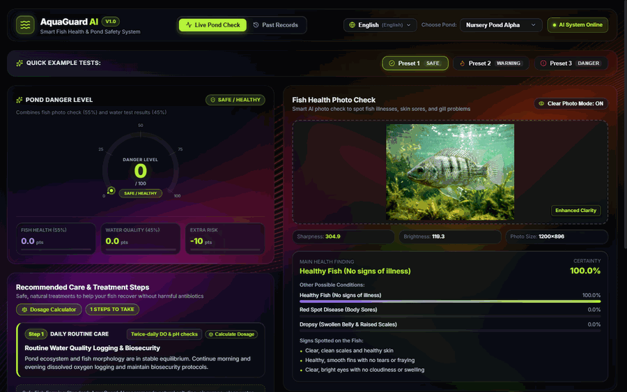
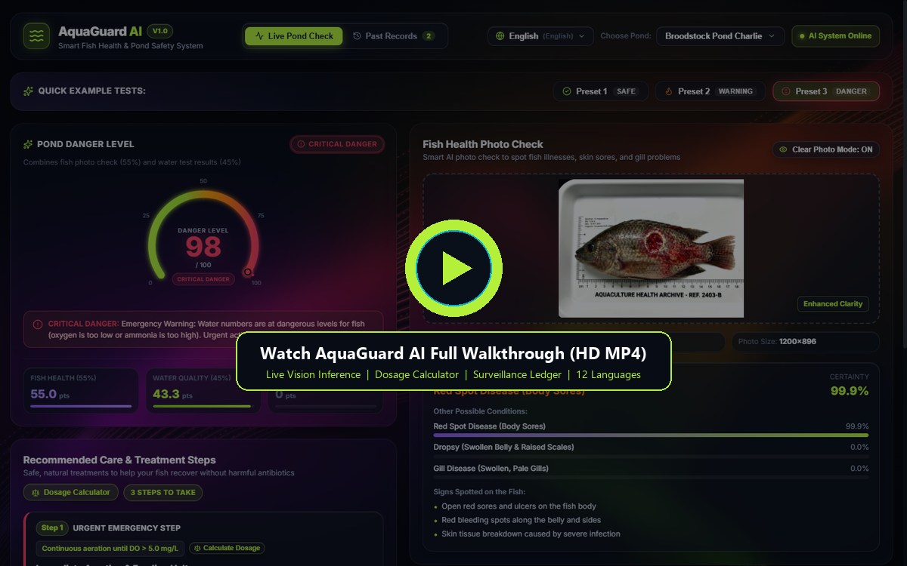
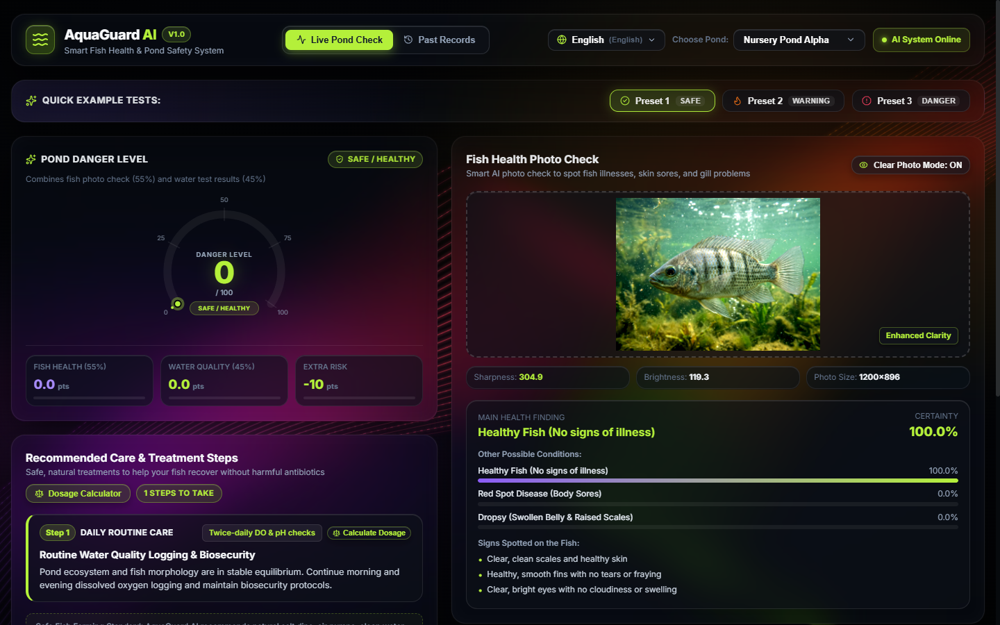
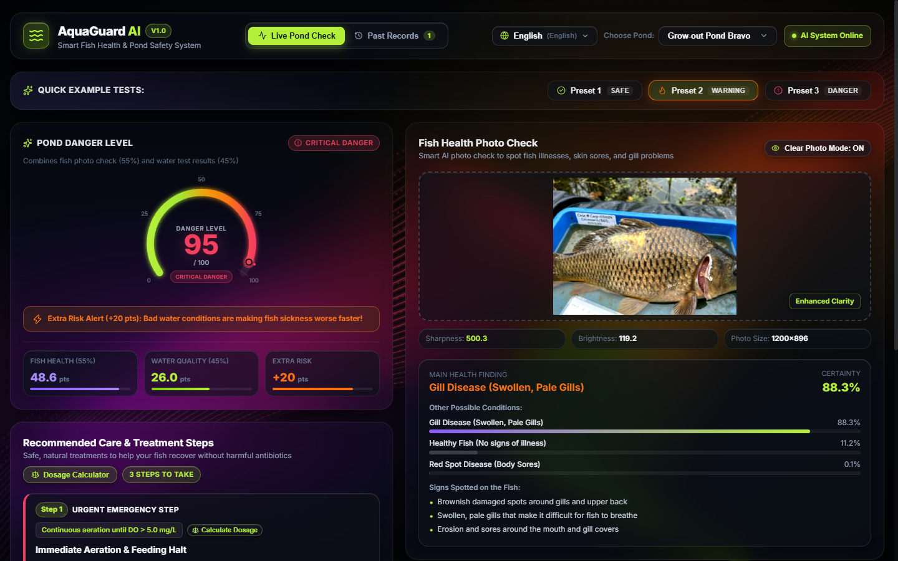
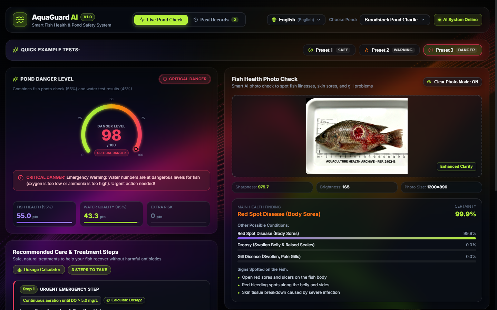
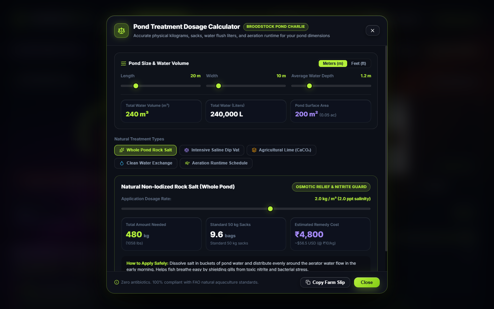
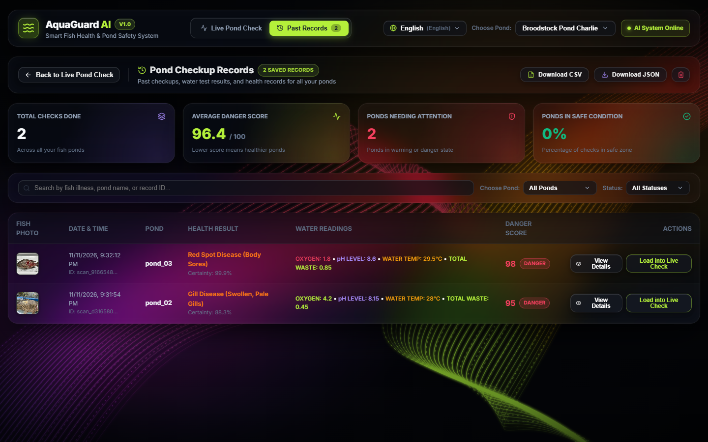
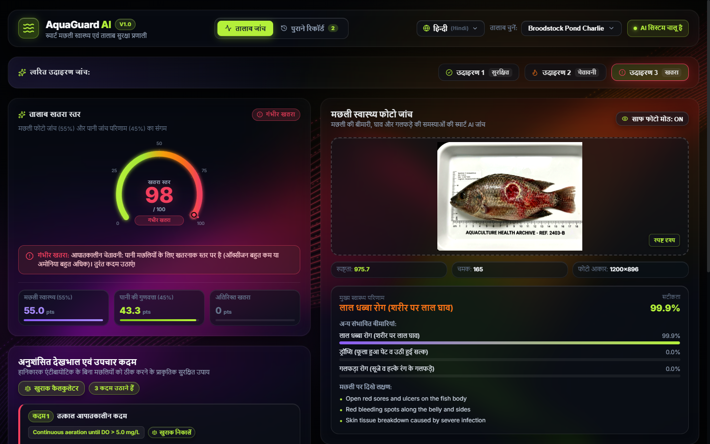
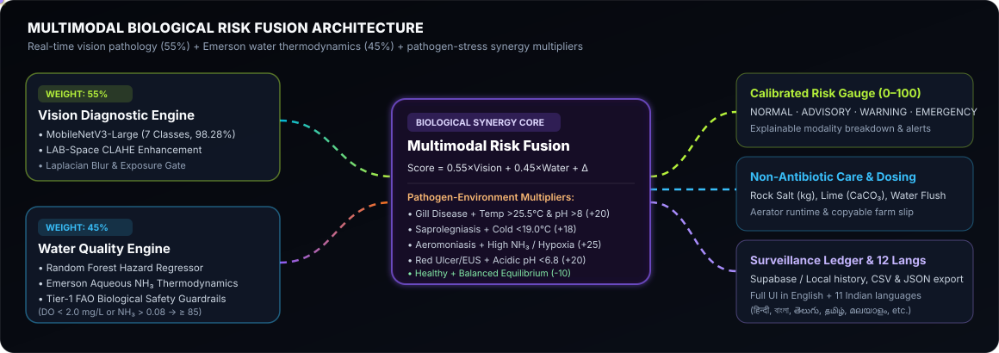

<div align="center">



<br />

[](backend/requirements.txt)
[](backend/app/main.py)
[](backend/app/services/vision_service.py)
[](frontend/package.json)
[](frontend/vite.config.js)
[](backend/tests/)
[](frontend/src/i18n/translations.js)

<p align="center">
  <strong>An intelligent multimodal early-warning and antibiotic-free treatment system for freshwater aquaculture ponds.</strong><br />
  Combines deep-learning fish lesion vision (<strong>98.28% test accuracy</strong>), Emerson aqueous ammonia thermodynamics, biological synergy modeling, a precision pond dosage calculator, and full localization across <strong>12 Indian languages</strong>.
</p>

<p align="center">
  <a href="#-live-animation-walkthrough">Live Animation</a> •
  <a href="#-full-hd-demo-video">HD Video</a> •
  <a href="#-visual-tour">Screenshots</a> •
  <a href="#-multimodal-fusion-architecture">Architecture</a> •
  <a href="#-model-benchmarks">Benchmarks</a> •
  <a href="#-quickstart">Quickstart</a> •
  <a href="#-api-endpoints">API</a>
</p>

</div>

---

## Why AquaGuard AI?

Freshwater pond outbreaks rarely happen from a single isolated cause—warm alkaline water accelerates **Columnaris** gill necrosis, acidic water accelerates **Epizootic Ulcerative Syndrome (Red Spot)**, and low dissolved oxygen compounds **un-ionized ammonia (NH₃)** toxicity overnight.

Instead of reacting after mass mortality or overusing restricted antibiotics, **AquaGuard AI** fuses two complementary signals in real time:

1. **Computer Vision Pathology (55% Weight)** — Analyzes a smartphone fish photo using **MobileNetV3-Large** across 7 freshwater health classes, paired with **LAB-space CLAHE** contrast enhancement and a Laplacian sharpness/exposure quality gate.
2. **Water Chemistry & Safety Guardrails (45% Weight)** — Evaluates Dissolved Oxygen (DO), pH, Temperature, Total Ammonia Nitrogen (TAN), and Turbidity using **Emerson (1975) aqueous ammonia thermodynamics**, a **Random Forest Hazard Regressor**, and **Tier-1 FAO biological guardrails**.
3. **Biological Synergy Engine** — Detects pathogen-environment interaction multipliers (e.g., Gill Disease + warm alkaline water adds **+20 risk points**) and generates an **antibiotic-free care plan** with exact physical pond dosages.

---

## 🎬 Live Animation Walkthrough

> Real-time capture of **AquaGuard AI** running live: GSAP-animated obsidian ambient ribbons, preset scenario switching (`Safe` → `Synergy Warning` → `Hypoxia Emergency`), the interactive Pond Treatment Dosage Calculator, Surveillance Ledger, and instant Hindi localization.

<div align="center">
  
</div>

---

## 🎥 Full HD Demo Video

Click the video preview below to watch or download the full **22-second HD walkthrough (`1280×800`, MP4)** with scene captions and live API interactions:

<div align="center">
  <a href="https://github.com/tahirazeem145/AquaGuard-AI/raw/main/docs/media/aquaguard-demo.mp4" title="Watch AquaGuard AI Full HD Demo Video (MP4)">
    
  </a>
  <br />
  <sub>
    Direct links: <a href="docs/media/aquaguard-demo.mp4">View in Repository (<code>docs/media/aquaguard-demo.mp4</code>)</a> •
    <a href="https://github.com/tahirazeem145/AquaGuard-AI/raw/main/docs/media/aquaguard-demo.mp4">Download / Stream Raw MP4 (7.1 MB)</a>
  </sub>
</div>

---

## 📸 Visual Tour

<table>
  <tr>
    <td width="50%" align="center">
      <strong>1. Healthy Pond Equilibrium (Risk 0 / 100)</strong><br /><br />
      
      <br />
      <sub>Clean water telemetry + Healthy Tilapia confirmed at <b>100.0%</b> certainty with stabilizing ecosystem credit.</sub>
    </td>
    <td width="50%" align="center">
      <strong>2. Pathogen-Water Synergy Alert (Risk 95 / 100)</strong><br /><br />
      
      <br />
      <sub>Gill Disease (<b>88.3%</b>) + warm alkaline water triggers <b>+20 pts Extra Risk</b> biological synergy multiplier.</sub>
    </td>
  </tr>
  <tr>
    <td width="50%" align="center">
      <strong>3. Emergency Guardrail Override (Risk 98 / 100)</strong><br /><br />
      
      <br />
      <sub>Red Spot Disease (<b>99.9%</b>) + severe hypoxia (DO 1.8 mg/L) triggers urgent non-antibiotic life-support steps.</sub>
    </td>
    <td width="50%" align="center">
      <strong>4. Natural Pond Treatment Dosage Calculator</strong><br /><br />
      
      <br />
      <sub>Computes exact rock salt (<b>kg</b> &amp; 50 kg sacks), lime (CaCO₃), dip tanks, water flush liters, and aerator hours.</sub>
    </td>
  </tr>
  <tr>
    <td width="50%" align="center">
      <strong>5. Multi-Pond Surveillance Ledger</strong><br /><br />
      
      <br />
      <sub>Dedicated audit screen with pond/tier filters, KPI summaries, modal inspection, and <b>CSV / JSON</b> export.</sub>
    </td>
    <td width="50%" align="center">
      <strong>6. Instant Indian Language Localization</strong><br /><br />
      
      <br />
      <sub>Full interface, diagnoses, and treatment advisories translated across <b>12 languages</b> (shown in हिन्दी).</sub>
    </td>
  </tr>
</table>

---

## 🧠 Multimodal Fusion Architecture

<div align="center">
  
</div>

### How the Composite Risk Score (`0 – 100`) Is Computed

| Stage | Component | Calculation / Rule |
| :--- | :--- | :--- |
| **1. Visual Risk** | [`vision_service.py`](backend/app/services/vision_service.py) | `0.0` if `Healthy Fish`; otherwise `confidence × 100 × 0.55` (up to `55.0 pts`). Pre-screened via Laplacian blur (`< 50.0`), brightness, and contrast checks. |
| **2. Water Hazard** | [`water_service.py`](backend/app/services/water_service.py) | `RandomForestRegressor` over `[DO, pH, Temp, TAN, Turbidity, Free NH₃]` weighted at `0.45` (up to `45.0 pts`). Free NH₃ computed via Emerson thermodynamics. |
| **3. Synergy Multiplier** | [`fusion_service.py`](backend/app/services/fusion_service.py) | • **Gill Disease / Columnaris** + `Temp > 25.5°C & pH > 8.0` → **`+20.0 pts`**<br>• **Saprolegniasis (Fungal)** + `Temp < 19.0°C` → **`+18.0 pts`**<br>• **Aeromoniasis / Tail & Fin Rot** + `NH₃ > 0.035 or DO < 3.5` → **`+25.0 pts`**<br>• **Parasitic / White Spot** + `Temp < 22.0°C or DO < 4.0` → **`+16.0 pts`**<br>• **Red Disease / EUS** + `pH < 6.8` → **`+20.0 pts`**<br>• **Healthy Fish** + optimal water equilibrium → **`-10.0 pts`** |
| **4. Safety Guardrail** | Biological Floor | Acute hypoxia (`DO < 2.0 mg/L`), lethal pH (`< 5.5` or `> 9.5`), or toxic NH₃ (`> 0.08 mg/L`) forces final risk score to **`≥ 85.0 (EMERGENCY)`**. |

---

## 📊 Model Benchmarks

### Vision Pathology Model — `MobileNetV3-Large`

Trained for 4 epochs on balanced freshwater fish pathology imagery (`406` held-out test samples, `58` per class — logged in [`metadata.json`](backend/models_weights/metadata.json) and [`classification_report_test.csv`](backend/models_weights/classification_report_test.csv)):

* **Test Accuracy:** **`98.28%`** (`0.9828`)
* **Macro F1-Score:** **`98.28%`** (`0.9828`)
* **Macro ROC-AUC (OvR):** **`0.9996`** (`0.99957`)

<details>
<summary><strong>View Per-Class Test Precision, Recall &amp; F1-Score (7 Classes)</strong></summary>

| Disease / Health Class | Precision | Recall | F1-Score | Support |
| :--- | :---: | :---: | :---: | :---: |
| **Bacterial Red disease** | 0.9825 | 0.9655 | 0.9739 | 58 |
| **Bacterial diseases - Aeromoniasis** | 1.0000 | 0.9655 | 0.9825 | 58 |
| **Bacterial gill disease** | 0.9825 | 0.9655 | 0.9739 | 58 |
| **Fungal diseases Saprolegniasis** | 1.0000 | 0.9828 | 0.9913 | 58 |
| **Healthy Fish** | 0.9831 | 1.0000 | 0.9915 | 58 |
| **Parasitic diseases** | 0.9355 | 1.0000 | 0.9667 | 58 |
| **Viral diseases White tail disease** | 1.0000 | 1.0000 | 1.0000 | 58 |
| **Overall / Macro Avg** | **0.9833** | **0.9828** | **0.9828** | **406** |

</details>

---

## 🌿 Zero-Antibiotic Natural Remediation & Dosage Calculator

Every clinical alert maps directly to FAO-aligned non-antibiotic care protocols in [`advisory_service.py`](backend/app/services/advisory_service.py) and an interactive calculator in [`TreatmentDosageCalculatorModal.jsx`](frontend/src/components/TreatmentDosageCalculatorModal.jsx):

* **Whole-Pond Rock Salt (`NaCl`)** — Computes exact kg, 50 kg bags, and estimated INR/USD cost from pond length × width × depth (`meters` or `feet`) at adjustable `1.0–3.0 kg/m³` salinity.
* **Intensive Saline Dip Vat** — Calculates salt weight for separate 15–30 min dip tanks (`1.5%–3.5%` solution).
* **Agricultural Lime (`CaCO₃`) Buffer** — Scales lime dosage based on water pH deficit to restore carbonate alkalinity.
* **Clean Water Flush & Aeration Schedule** — Estimates replacement water volume (`15%–40%` exchange) and emergency aerator hours based on Dissolved Oxygen readings, with one-click **Copy Farm Slip**.

---

## 🌐 Multilingual Regional Accessibility (12 Languages)

Built for field farmers and aquaculture extension officers across India in [`translations.js`](frontend/src/i18n/translations.js):

| Code | Language | Native Script | Primary Region |
| :--- | :--- | :--- | :--- |
| `en` | English | English | All India |
| `hi` | Hindi | हिन्दी | North & Central India |
| `bn` | Bengali | বাংলা | West Bengal, Tripura, Assam |
| `te` | Telugu | తెలుగు | Andhra Pradesh & Telangana |
| `ta` | Tamil | தமிழ் | Tamil Nadu & Puducherry |
| `ml` | Malayalam | മലയാളം | Kerala |
| `kn` | Kannada | ಕನ್ನಡ | Karnataka |
| `or` | Odia | ଓଡ଼ିଆ | Odisha |
| `mr` | Marathi | मराठी | Maharashtra |
| `gu` | Gujarati | ગુજરાતી | Gujarat |
| `as` | Assamese | অসমীয়া | Assam & North-East |
| `pa` | Punjabi | ਪੰਜਾਬੀ | Punjab & Haryana |

---

## 🚀 Quickstart

### Prerequisites
* **Python 3.10+** (verified on Python `3.12.10`)
* **Node.js 18+** & **npm**

### 1. Clone the Repository
```bash
git clone https://github.com/tahirazeem145/AquaGuard-AI.git
cd AquaGuard-AI
```

### 2. Start the FastAPI Backend (`http://localhost:8000`)
```bash
# Create & activate virtual environment
python -m venv .venv
# Windows PowerShell:
.\.venv\Scripts\Activate.ps1
# macOS / Linux:
# source .venv/bin/activate

# Install core backend + ML runtime dependencies
pip install -r backend/requirements.txt
pip install torch torchvision opencv-python-headless joblib

# Launch API microservice
python backend/run.py
```
Interactive docs are immediately available at **[http://localhost:8000/docs](http://localhost:8000/docs)** and **[http://localhost:8000/redoc](http://localhost:8000/redoc)**.

### 3. Start the React + Vite Frontend (`http://localhost:5173`)
In a second terminal:
```bash
cd frontend
npm install
npm run dev
```
Open **[http://localhost:5173/](http://localhost:5173/)** in your browser. Vite proxies `/api/*` and `/health` automatically to `http://127.0.0.1:8000` (see [`frontend/vite.config.js`](frontend/vite.config.js)).

---

## 🔌 API Endpoints

| Method | Endpoint | Purpose |
| :--- | :--- | :--- |
| `GET` | `/health` | System & engine readiness check (`vision_engine`, `water_engine`) |
| `POST` | `/api/v1/analyze-fish` | Standalone fish lesion classification (`image` upload + quality metrics) |
| `POST` | `/api/v1/water-quality` | Standalone water hazard score, free NH₃ calculation & FAO compliance |
| `POST` | `/api/v1/assess-pond` | Full multimodal fusion (`image` + water telemetry) → Risk Score + Care Plan |
| `GET` | `/api/v1/ponds` | List monitored aquaculture ponds and status |
| `GET` | `/api/v1/ponds/{pond_id}/history` | Retrieve historical pond assessments |
| `GET` | `/api/v1/demo-presets` | Fetch calibrated demonstration scenarios |

---

## 🧪 Running Tests

The automated integration and end-to-end scenario test suites live in [`backend/tests/`](backend/tests/):

```bash
pytest backend/tests/ -v
```
All **9 tests** across [`test_api.py`](backend/tests/test_api.py) and [`test_e2e_scenarios.py`](backend/tests/test_e2e_scenarios.py) verify health checks, standalone vision/water inference, unified multimodal fusion, optimal equilibrium, Columnaris heat-alkalinity synergy, and nighttime hypoxia emergency guardrails.

---

## 📁 Repository Structure

```text
AquaGuard AI/
├── backend/
│   ├── app/
│   │   ├── api/v1/endpoints/        # fish_analysis, water_quality, pond_assessment, ponds
│   │   ├── core/                    # config & upload security validations
│   │   ├── models/                  # Pydantic v2 request/response schemas
│   │   └── services/                # vision, water, fusion, advisory, supabase, RF trainer
│   ├── models_weights/              # best_model.pt (MobileNetV3), water_hazard_rf.pkl, metrics
│   ├── tests/                       # 9 automated API & E2E scenario tests
│   └── run.py                       # Uvicorn launcher (:8000)
├── frontend/
│   ├── public/samples/              # Sample Tilapia/Carp specimens for one-click presets
│   └── src/
│       ├── components/              # Header, RiskGauge, DiagnosticScanner, WaterTelemetryPanel,
│       │                            # ActionPlanCard, TreatmentDosageCalculatorModal,
│       │                            # SurveillanceLedgerScreen, AmbientRibbonBackground
│       ├── i18n/                    # 12-language React Context & translation dictionaries
│       └── services/api.js          # Typed fetch service & demo preset configs
├── docs/media/                      # Animated SVGs, live GIF walkthrough, HD MP4 demo & screenshots
├── mrd/ & prd/                      # Market & Product Requirement specifications (MD, HTML, PDF)
├── research/                        # Pathology, dataset, feasibility & solution research notes
└── scripts/                         # PDF documentation generation utilities
```

---

<div align="center">
  <sub>Built with PyTorch, Scikit-Learn, FastAPI, React 19, GSAP &amp; Lenis — engineered for sustainable, antibiotic-free freshwater aquaculture.</sub>
</div>
