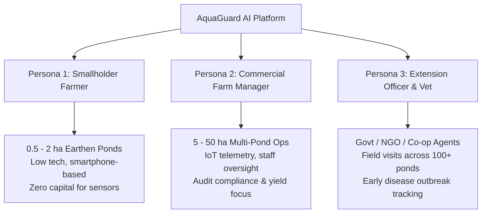

# Market Requirements Document (MRD)
# AquaGuard AI: Fish Disease Risk Detection & Early Warning System

**Document Version:** 1.0  
**Status:** Approved / Baseline  
**Date:** 2026-10-31  
**Author:** AquaGuard AI Product & Research Team  
**Target Market:** Global Inland Freshwater Aquaculture (Focus: South & Southeast Asia, Sub-Saharan Africa)  

---

## 1. Executive Summary & Market Opportunity

### 1.1 The Macroeconomic Imperative
Aquaculture is the fastest-growing agri-food sector in the world, now providing **over 50% of all aquatic food consumed globally** (FAO SOFIA 2024 Report). By 2030, global aquatic food production must expand by an additional 15% to meet the dietary protein requirements of a growing global population under the United Nations Sustainable Development Goals (SDG 2: Zero Hunger; SDG 14: Life Below Water).

However, biological instability and infectious disease outbreaks represent the single greatest operational and financial threat to this expansion. According to assessments by the **World Bank and the Food and Agriculture Organization (FAO)**:
* **Global Annual Direct Losses:** Over **$6.0 Billion USD** in direct fish and crustacean biomass mortality per annum.
* **National Sector Tolls:** In India, aquatic animal diseases inflict an estimated annual loss of **$2.48 Billion USD** (~15% of total sector output value); in Vietnam, annual losses exceed **$1.0 Billion USD**.
* **Microeconomic Impact:** For a typical smallholder operating a 1-hectare earthen pond, a single uncontrolled disease outbreak (e.g., *Aeromonas* septicemia, White Spot, or Columnaris) results in an 80–100% crop loss, wiping out an entire season's capital investment and driving rural farming families into severe debt.

```
┌────────────────────────────────────────────────────────────────────────┐
│                     THE AQUACULTURE DISEASE CRISIS                     │
├───────────────────────────────────┬────────────────────────────────────┤
│ Global Annual Financial Losses    │ $6.0+ Billion USD per year         │
├───────────────────────────────────┼────────────────────────────────────┤
│ Smallholder Farm Representation   │ >85% of total global producers     │
├───────────────────────────────────┼────────────────────────────────────┤
│ Diagnostic Laboratory Lead Time   │ 3 to 5 business days (too late)    │
├───────────────────────────────────┼────────────────────────────────────┤
│ Reactive Chemical/Antibiotic Cost │ 15% to 20% of total farm OpEx      │
├───────────────────────────────────┼────────────────────────────────────┤
│ Current Industrial Sensor Cost    │ $10,000 – $50,000 (Out of reach)   │
└───────────────────────────────────┴────────────────────────────────────┘
```

### 1.2 Market Sizing (TAM, SAM, SOM)
* **Total Addressable Market (TAM):** **$310 Billion USD** — The entire global aquaculture production market, spanning freshwater finfish, marine finfish, crustaceans, and mollusks across 130+ million metric tonnes of annual output.
* **Serviceable Addressable Market (SAM):** **$38.4 Billion USD** — The global freshwater pond aquaculture health management, water monitoring, feed diagnostics, and veterinary bio-security sector, heavily concentrated in developing nations (India, Bangladesh, Vietnam, Indonesia, Philippines, Nigeria, Egypt).
* **Serviceable Obtainable Market (SOM):** **$240 Million USD** — The addressable segment of small- to medium-scale commercial and semi-intensive freshwater pond farmers in South and Southeast Asia seeking smartphone-accessible, low-cost diagnostic software and early-warning intelligence over a 3-year horizon.

---

## 2. Target Customer Personas & Market Segments

AquaGuard AI serves three distinct customer archetypes with specific operational realities:



### 2.1 Persona 1: "Ramesh" – Smallholder Fish Farmer (Primary Target)
* **Demographics:** Age 38, operates two 1-acre earthen ponds in Odisha, India; cultivates Indian Major Carps (Rohu, Catla) and Nile Tilapia.
* **Technology Profile:** Owns a low-cost Android smartphone (4G connectivity, intermittent in rural fields); uses WhatsApp and YouTube; limited English fluency (prefers local language or visual icons).
* **Workday Reality:** Inspects ponds at dawn and dusk; monitors feeding behavior from pond dykes; occasionally catches fish using a hand scoop net to check growth.
* **Core Frustrations:**
  * Cannot see beneath the murky pond water; only notices disease when dead fish float to the surface.
  * Cannot afford $1,000 electronic dissolved oxygen meters; relies on subjective water smell or seeing fish gasp at the surface.
  * Local chemical dealer sells expensive antibiotics that often don't work or poison the pond.
* **Jobs to be Done (JTBD):** *"When I net a sluggish fish with spots or frayed fins, I want to take a quick photo with my phone and know immediately what disease it is, what water parameter went wrong, and exactly what affordable treatment (salt, lime, water exchange) to apply today so I don't lose my harvest."*

### 2.2 Persona 2: "Vikram" – Commercial Pond Farm Manager
* **Demographics:** Age 45, manages a 25-hectare commercial semi-intensive farm with 12 distinct nursery and grow-out ponds in Andhra Pradesh, India.
* **Technology Profile:** Proficient with web dashboards, laptop and smartphone; utilizes digital accounting software; open to IoT sensors.
* **Core Frustrations:**
  * Farm laborers fail to record water parameters accurately or miss early signs of fin erosion across distant ponds.
  * Disease outbreaks in one nursery pond quickly spread farm-wide via shared equipment or inlet canals.
  * Export processing facilities enforce strict zero-tolerance testing for antibiotic residues (chloramphenicol, nitrofurans); a single contaminated consignment causes complete shipment rejection.
* **Jobs to be Done (JTBD):** *"I want a single centralized dashboard to monitor all 12 ponds, track daily water quality trends, receive automated alerts when disease risk rises, and enforce non-antibiotic biosecurity protocols across my workforce."*

### 2.3 Persona 3: "Dr. Ananya" – Fisheries Extension Officer / Cooperative Vet
* **Demographics:** Age 32, government field officer overseeing 150+ smallholder aquaculture ponds across a rural district.
* **Technology Profile:** Uses laptop and tablet; frequently travels between remote villages with spotty cellular coverage.
* **Core Frustrations:**
  * Overburdened; cannot physically visit every pond before disease spreads across the river basin.
  * Farmers call her after fish have already been dead for 48 hours, making post-mortem diagnosis difficult.
  * Lacks rapid field diagnostic kits; sending tissue samples to the state university takes 5 days.
* **Jobs to be Done (JTBD):** *"I want a standardized mobile diagnostic screening tool that farmers can use in the field to submit structured visual and water reports, enabling me to triage regional outbreaks and recommend interventions remotely."*

---

## 3. Customer Pain Points & Unmet Market Needs

| Pain Point ID | Real-World Problem | Current Market Workaround | Business & Operational Impact |
| :--- | :--- | :--- | :--- |
| **PP-01: Optical Invisibility** | Freshwater pond water is turbid (algae/silt); sub-surface symptoms are invisible until fish surface near death. | Naked-eye observation from pond embankments during feeding. | Catastrophic latency; 40–80% mortality before disease is recognized. |
| **PP-02: Sensor Cost Barrier** | High-precision commercial optical DO and multiparameter sondes cost $1,500–$5,000+ each. | Farmers use no sensors or buy unreliable $15 chemical titration drop kits that expire quickly. | Water crashes (nocturnal hypoxia, ammonia spikes) go completely undetected until mass suffocation occurs. |
| **PP-03: Laboratory Vacuum** | Diagnostic veterinary labs are located in urban university centers 50–200 km away from rural farms. | Farmers consult local feed/chemical salesmen who push high-margin proprietary chemicals. | Wrong treatments applied; 15–20% of operating expenditure wasted on ineffective chemicals. |
| **PP-04: Antibiotic Dependency & AMR** | Blind deployment of human and veterinary antibiotics (oxytetracycline, ciprofloxacin) as a panic response. | Farmers dump antibiotics directly into pond water without veterinary prescriptions. | Proliferation of drug-resistant pathogens; biofilter bacteria collapse; international export bans. |
| **PP-05: Siloed Diagnostics** | Existing tools only measure water OR classify images, never correlating the two. | Manual guesswork trying to connect a water test result with a skin lesion. | Misses the biological reality: poor water quality is the direct trigger that causes pathogens to attack. |

---

## 4. Competitive Landscape & Positioning

### 4.1 Competitor Analysis Matrix

| Solution | Target Market | Key Technologies | Pros | Cons & Market Gaps | Pricing |
| :--- | :--- | :--- | :--- | :--- | :--- |
| **Aquabyte** (Norway/US) | Industrial Atlantic Salmon (Marine Net Pens) | Submersible stereo HD cameras, deep CNNs, edge computing | Highly automated sea lice counting, biomass calculation | Marine cages only; completely ineffective in turbid freshwater ponds; extreme cost. | **Enterprise Subscription:** $2,000 – $5,000 / cage / month |
| **XpertSea** (Canada) | Commercial Shrimp Hatcheries & Ponds | Optical imaging hardware, mobile computer vision | Accurate shrimp counting, size distribution, harvest timing | Requires specialized physical hardware bucket; focused on shrimp, not finfish disease triage. | **Hardware + SaaS:** $3,000 – $7,000 setup |
| **eFishery** (Indonesia) | Freshwater Carp & Tilapia Farmers | Smart automated feeder, acoustic appetite sensors, IoT telemetry | Excellent feeding efficiency, established distribution network | Primarily an automated feeder; basic water logging; lacks computer vision disease diagnostics. | **Feeder Lease / Purchase:** $200 – $500 per unit |
| **Manual Drop Test Kits** (API, Hanna, Merck) | All Aquaculture | Chemical reagent titration / colorimetric test strips | Low upfront cost ($20–$50); no electricity required | Highly subjective color matching; tedious manual testing; zero automated alerts or advice. | **Consumable Cost:** $20 – $50 per kit (lasts 30 tests) |
| **AquaGuard AI** *(Our Solution)* | **Smallholder & Commercial Freshwater Pond Farms** | **MobileNetV3 CV + Random Forest Telemetry + Multimodal Risk Fusion Engine** | **Zero hardware requirement; smartphone camera ready; multimodal risk scoring; step-by-step non-antibiotic action plans.** | **Requires initial network connection for cloud inference; relies on user-submitted photos.** | **Freemium MVP ($0 for smallholders; Tiered SaaS for commercial farms)** |

### 4.2 AquaGuard AI Competitive Differentiation ("The Moat")
1. **Multimodal Environmental & Pathological Risk Fusion:** We are the only platform that explicitly links physical water chemistry ($DO$, $pH$, $Temp$, $NH_3$) with visual dermatological symptoms through an interpretable biological synergy engine.
2. **Zero Capital Expenditure (No Expensive Hardware Required):** Smallholders can use their existing smartphones. Water telemetry can be entered via interactive UI sliders (using simple farm drop kits) OR streamed from low-cost IoT nodes.
3. **Prescriptive, Non-Chemical Agronomic Action Plans:** Rather than returning a useless raw label like *"82% Columnaris"*, AquaGuard AI outputs immediate, step-by-step remedial protocols (e.g. *"Run paddlewheel aerator for 4 hours; apply 3 ppt non-iodized salt bath; withhold feeding today"*).
4. **Offline-First & Mobile-Optimized:** Built with progressive caching and client-side image compression, functioning reliably even on weak rural 2G/3G networks.

---

## 5. Value Proposition & Business Model

### 5.1 Value Proposition by Stakeholder
* **For Smallholder Farmers:** *"Protect your entire season's fish harvest from mass mortality using just your smartphone, without buying expensive sensors or wasting money on useless antibiotics."*
* **For Commercial Farm Managers:** *"Gain real-time visibility across all your ponds, cut operational losses by up to 35%, ensure zero antibiotic residue rejections, and streamline staff workflows from a single dashboard."*
* **For Governments & Cooperatives:** *"Real-time regional biosurveillance map tracking disease vectors, preventing regional epidemics, and promoting sustainable, export-grade aquaculture biosecurity."*

### 5.2 Monetization & Business Model (Go-to-Market Strategy)

```
┌────────────────────────────────────────────────────────────────────────┐
│                      AQUAGUARD AI BUSINESS MODEL                       │
├──────────────────┬──────────────────┬──────────────────────────────────┤
│ TIER             │ TARGET AUDIENCE  │ PRICING & FEATURES               │
├──────────────────┼──────────────────┼──────────────────────────────────┤
│ 1. Community     │ Smallholders     │ • FREE ($0 / month forever)      │
│    (Freemium)    │ (1-2 Ponds)      │ • Up to 20 AI image scans/month  │
│                  │                  │ • Manual water quality sliders   │
│                  │                  │ • Standard biosecurity action plan│
├──────────────────┼──────────────────┼──────────────────────────────────┤
│ 2. Pro Farm      │ Semi-Intensive & │ • $15 – $35 / farm / month       │
│    (Commercial)  │ Commercial Farms │ • Unlimited AI scans across ponds│
│                  │ (3-20 Ponds)     │ • Automated IoT telemetry sync   │
│                  │                  │ • Historical trend analytics     │
│                  │                  │ • SMS / WhatsApp alert dispatch  │
├──────────────────┼──────────────────┼──────────────────────────────────┤
│ 3. Enterprise    │ Hatcheries, Feed │ • Custom Annual Contract         │
│    / Government  │ Companies, State │ • Regional disease epidemiology  │
│    (B2B & B2G)   │ Fisheries Depts  │ • White-label extension app      │
│                  │                  │ • API access for farm sensor ERP │
└──────────────────┴──────────────────┴──────────────────────────────────┘
```

### 5.3 Distribution & GTM Partnerships
* **Phase 1 (Hackathon & Community Pilots):** Partner with local aquaculture cooperatives and university fisheries extension programs in Odisha and Andhra Pradesh (India) to onboard 50 smallholders for pilot testing.
* **Phase 2 (Feed & Fingerling Distributor Distribution):** Distribute AquaGuard AI access through rural fish feed distributors (e.g. CP Group, Godrej Agrovet, Cargill) who bundle the app as a value-add service to increase farmer harvest survival.
* **Phase 3 (Government Extension Integration):** Integrate with state fisheries department schemes (e.g., PMMSY - Pradhan Mantri Matsya Sampada Yojana in India) as a certified digital extension tool.

---

## 6. Market Success Metrics & Key Performance Indicators (KPIs)

To evaluate market viability and real-world impact, AquaGuard AI defines the following operational KPIs:

```
                  ┌─────────────────────────────────────┐
                  │      AQUAGUARD AI MARKET KPIS       │
                  └──────────────────┬──────────────────┘
                                     │
        ┌────────────────────────────┼────────────────────────────┐
        ▼                            ▼                            ▼
 [Farmer Economics]         [Diagnostic Impact]         [Ecosystem / AMR]
 • >25% reduction in        • >92% visual diagnostic    • >40% reduction in
   disease mortality          accuracy in field           injudicious antibiotic
 • >15% savings in          • <5 sec end-to-end           applications
   chemical / drug spend      scan-to-advisory speed    • 100% adherence to FAO
 • 1.4x - 1.8x ROI per      • >70% Monthly Active         prescriptive water
   production cycle           Users (MAU) in pilots       safety guidelines
```

---

## 7. Regulatory, Environmental, and Biosecurity Compliance

1. **Antimicrobial Resistance (AMR) & One Health Alignment:** AquaGuard AI aligns directly with the WHO/FAO/WOAH "One Health" Global Action Plan by prioritizing non-chemical, water remediation, and biosecurity interventions over antibiotic treatments.
2. **Diagnostic Disclaimer & Veterinary Compliance:** AquaGuard AI is marketed strictly as a **"Risk Screening and Early Warning Decision Support Tool"**, not an official certification of animal health. Suspected high-mortality viral pathogens (TiLV, KHV) automatically trigger guidance directing farmers to certified government veterinary diagnostic laboratories.
3. **Data Privacy & Agronomic Security:** Farmer pond data, geolocation, and yield metrics are encrypted via Supabase PostgreSQL Row-Level Security (RLS) to ensure farmer confidentiality and proprietary harvest data protection.

