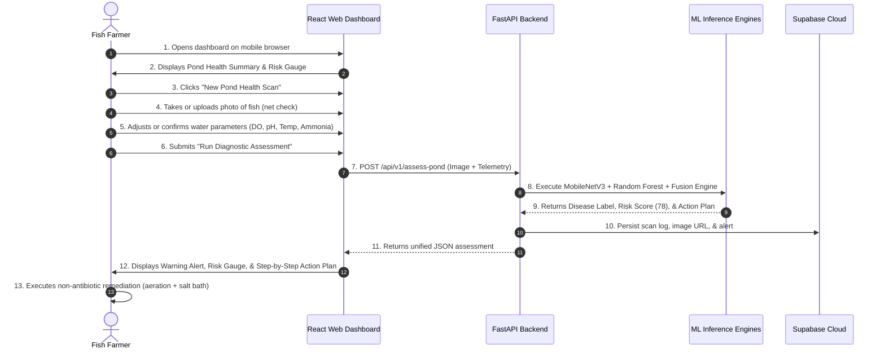
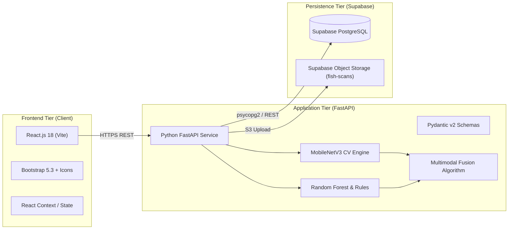

# Product Requirements Document (PRD)
# AquaGuard AI: Fish Disease Risk Detection & Early Warning System

**Document Version:** 1.0  
**Status:** Approved / Engineering Baseline  
**Date:** 2026-10-31  
**Target Release:** Hackathon Prototype (MVP V1.0)  
**Authors:** Senior Software Architect, AI/ML Engineer, and Product Team  

---

## 1. Product Overview & Strategic Goals

### 1.1 Product Vision
**AquaGuard AI** is an intelligent, accessible, multimodal disease risk detection and early warning platform engineered specifically for freshwater aquaculture pond ecosystems. It empowers smallholder fish farmers and commercial pond managers to detect infectious fish diseases early, monitor water quality degradation, understand environmental pathogen triggers, and execute immediate, non-antibiotic mitigation protocols—all through an intuitive, mobile-optimized web application.

### 1.2 Core Product Objectives
1. **Accurate Visual Pathogen Screening:** Classify 6 major freshwater fish diseases plus healthy status with >92% validation accuracy using a fine-tuned MobileNetV3 deep learning model.
2. **Real-time Environmental Hazard Tracking:** Evaluate key water parameters (Dissolved Oxygen, pH, Temperature, Ammonia) against biological safety limits using a hybrid Random Forest and FAO guardrail engine.
3. **Multimodal Risk Fusion:** Synthesize visual diagnostic probabilities with environmental hazard metrics into a unified, calibrated **Composite Pond Health Risk Score (0–100)**.
4. **Actionable Farm-Level Prescriptions:** Translate diagnostic classifications into clear, step-by-step agronomic action plans (aeration schedules, salt baths, water exchange rates, quarantine steps).
5. **Frictionless Demo Experience:** Deliver a responsive, stable web dashboard featuring pre-loaded, one-click demonstration scenarios designed for rapid hackathon judge evaluation.

### 1.3 Out-of-Scope (Non-Goals for MVP V1.0)
* ❌ Solder and deploy physical edge IoT hardware (ESP32 / LoRaWAN buoys).
* ❌ Continuous underwater video stream object tracking or underwater camera hardware.
* ❌ Native iOS / Android app store packaging (responsive web app meets all mobile requirements).
* ❌ Automated mechanical motor controls for pond aerators or feeding units.
* ❌ Native multi-dialect voice synthesis / speech recognition.

---

## 2. User Personas & User Journeys

### 2.1 Primary User Persona
* **Name:** Ramesh, Smallholder Fish Farmer (1.5 ha pond).
* **Goal:** Quickly diagnose moribund or spotted fish caught during morning feeding, check pond safety, and apply the correct low-cost remedy immediately.
* **Tech Context:** Low-to-mid range Android phone, mobile browser, intermittent 4G/3G connectivity.

### 2.2 End-to-End User Journey Walkthrough



---

## 3. Functional Requirements (MoSCoW Prioritization)

```
┌────────────────────────────────────────────────────────────────────────┐
│               AQUAGUARD AI FUNCTIONAL REQUIREMENTS MATRIX              │
├─────────┬────────────────────────────────────────────┬─────────────────┤
│ ID      │ Feature / Capability                       │ MoSCoW Priority │
├─────────┼────────────────────────────────────────────┼─────────────────┤
│ FR-01   │ Fish Image Intake & Client Preprocessing   │ MUST HAVE (P0)  │
│ FR-02   │ Computer Vision Disease Classification     │ MUST HAVE (P0)  │
│ FR-03   │ Water Quality Telemetry Input & Evaluation │ MUST HAVE (P0)  │
│ FR-04   │ Multimodal Risk Fusion Engine              │ MUST HAVE (P0)  │
│ FR-05   │ Early Warning & Prescriptive Action Engine │ MUST HAVE (P0)  │
│ FR-06   │ Interactive Dashboard & Live Risk Gauge    │ MUST HAVE (P0)  │
│ FR-07   │ 3 Pre-Loaded Judge Demonstration Presets   │ MUST HAVE (P0)  │
│ FR-08   │ Supabase Storage & Historical Scan Log     │ SHOULD HAVE (P1)│
│ FR-09   │ PDF / Print Diagnostic Report Export       │ COULD HAVE (P2) │
│ FR-10   │ Simulated Automated IoT Stream Mode        │ COULD HAVE (P2) │
│ FR-11   │ Continuous Underwater Camera Object Stream │ WON'T HAVE (P3) │
└─────────┴────────────────────────────────────────────┴─────────────────┘
```

### 3.1 FR-01: Fish Image Intake & Client Preprocessing (P0)
* **Description:** The system must allow users to upload an image from file storage or capture directly via a mobile device camera.
* **Requirements:**
  * Support formats: `image/jpeg`, `image/png`, `image/webp`.
  * Maximum upload file size: 10 MB.
  * Client-side preview displayed immediately after selection.
  * Automatic client-side canvas pre-compression to reduce rural upload payload to <300 KB.
  * In-app guideline overlay showing proper fish framing (lateral body view, dorsal view for dropsy).

### 3.2 FR-02: Computer Vision Disease Diagnostic Engine (P0)
* **Description:** The backend must execute deep learning inference on uploaded fish images.
* **Requirements:**
  * Backbone model: `MobileNetV3-Large` pre-trained on ImageNet and fine-tuned on the South Asian Freshwater Fish Disease dataset.
  * 7 Supported Target Classes:
    1. `Healthy Fish`
    2. `Ichthyophthiriasis (White Spot Disease)`
    3. `Fin and Tail Rot`
    4. `Columnaris Disease (Saddleback / Cotton-mouth)`
    5. `Saprolegniasis (Water Mold)`
    6. `Dropsy / Ascites`
    7. `Epizootic Ulcerative Syndrome (EUS)`
  * Output requirements: Top-1 predicted pathology, confidence percentage ($0.00 - 1.00$), and Top-3 differential diagnosis probability distribution.
  * CPU inference latency benchmark: $\le 45 \text{ ms}$.

### 3.3 FR-03: Water Quality Telemetry Input & Evaluation (P0)
* **Description:** The system must accept and evaluate critical physicochemical water parameters.
* **Supported Parameters & Ranges:**
  * **Dissolved Oxygen ($DO$):** $0.0 - 15.0 \text{ mg/L}$ (Critical threshold: $< 3.5 \text{ mg/L}$, Lethal: $< 2.0 \text{ mg/L}$).
  * **Potential of Hydrogen ($pH$):** $0.0 - 14.0$ (Normal safe range: $6.8 - 8.2$; Critical: $< 6.0$ or $> 9.0$).
  * **Water Temperature ($T$):** $10.0 - 40.0^\circ\text{C}$ (Normal: $24 - 30^\circ\text{C}$; Acute drop alert: $> 3^\circ\text{C}$ drop).
  * **Total Ammonia Nitrogen ($TAN$):** $0.0 - 5.0 \text{ mg/L}$ (Dynamic calculation of un-ionized ammonia $NH_3$; Toxic: $> 0.05 \text{ mg/L}$).
  * **Turbidity / Secchi Depth:** $0 - 200 \text{ NTU}$ / $5 - 60 \text{ cm}$.
* **Evaluation Engine:**
  * Tier 1: Deterministic Biological Guardrail (immediate override if DO or Ammonia violates lethal limits).
  * Tier 2: Scikit-learn Random Forest regressor outputting an **Environmental Hazard Score ($H_{env} \in [0, 100]$)**.

### 3.4 FR-04: Multimodal Risk Fusion Engine (P0)
* **Description:** Fuses the visual pathology output with environmental hazard telemetry into a calibrated composite metric.
* **Mathematical Formula:**
  $$R_{pond} = \min\left(100, \; 0.55 \cdot (P_{max} \times 100) + 0.45 \cdot H_{env} + S(C_{disease}, \mathbf{X}_{env})\right)$$
* **Synergy Multipliers ($S$):**
  * *Columnaris* detected + Warm alkaline water ($T > 26^\circ\text{C}$, $pH > 8.2$): $+20$ points.
  * *Saprolegniasis* detected + Temperature drop ($T < 18^\circ\text{C}$): $+15$ points.
  * *Fin Rot* detected + High Ammonia ($NH_3 > 0.05 \text{ mg/L}$) + Hypoxia ($DO < 3.5 \text{ mg/L}$): $+25$ points.
  * *White Spot* detected + Thermal instability ($|\Delta T| > 3^\circ\text{C}$): $+15$ points.
* **Risk Tiers:**
  * `NORMAL (0 - 30)`: Green indicator. Safe conditions.
  * `ADVISORY (31 - 60)`: Yellow indicator. Moderate environmental stress.
  * `WARNING (61 - 80)`: Orange indicator. High pathogen/stress probability.
  * `EMERGENCY (81 - 100)`: Red flashing indicator. Imminent or active mass mortality.

### 3.5 FR-05: Early Warning & Prescriptive Action Plan Generator (P0)
* **Description:** Generates structured, farmer-friendly remediation steps prioritizing non-antibiotic interventions.
* **Requirements:**
  * Output at least 3 prioritized action items for any risk tier $> 30$.
  * Provide concrete numbers: e.g. *"Apply agricultural lime at 200 kg/hectare"*, *"Operate aerator for 4 continuous hours"*, *"Prepare a 3 ppt (3 g/L) salt dip for sampled fish"*.
  * Categorize actions: `Immediate Biosecurity`, `Water Remediation`, `Therapeutic Intervention`.

### 3.6 FR-06: Interactive Dashboard & Live Visualizations (P0)
* **Description:** Responsive React.js + Bootstrap 5 single-page application.
* **Key Components:**
  * Semi-circular SVG gauge displaying $R_{pond}$ with smooth animation.
  * Dynamic color-coded status badges for all water parameters (Optimal, Warning, Critical).
  * Multi-pond summary cards (e.g. Pond #1, Pond #2, Pond #3).
  * Collapsible diagnostic drawer showing Top-3 disease probability bars.

### 3.7 FR-07: One-Click Pre-Loaded Judge Demonstration Presets (P0)
* **Description:** 3 dedicated demo buttons on the UI to guarantee rapid, bulletproof hackathon judge presentations:
  1. **Demo Preset 1: "Severe White Spot Outbreak"** (Loads sample Ich photo, $T = 20^\circ\text{C}$, $DO = 4.2 \text{ mg/L}$ -> Triggers WARNING Alert, Score = 78, Salt dip advisory).
  2. **Demo Preset 2: "Nighttime Hypoxia Emergency"** (Loads moribund surface piping fish photo, $DO = 1.8 \text{ mg/L}$, $NH_3 = 0.08 \text{ mg/L}$ -> Triggers EMERGENCY Alert, Score = 92, Emergency aeration advisory).
  3. **Demo Preset 3: "Optimal Pond Equilibrium"** (Loads healthy carp photo, $DO = 6.8 \text{ mg/L}$, $pH = 7.4$, $T = 28^\circ\text{C}$ -> Confirms NORMAL, Score = 14, Green status).

### 3.8 FR-08: Supabase Storage & Historical Scan Log (P1)
* **Description:** Persists all scan records, uploaded images, and calculated risk scores in Supabase PostgreSQL and Object Storage.
* **Requirements:**
  * Display a historical audit log table with image thumbnails, timestamps, predicted disease, and risk score badge.
  * Support filtering by pond ID and severity tier.

---

## 4. Non-Functional Requirements (NFRs)

### 4.1 Performance & Latency
* **Inference Speed:** CNN image classification forward pass must complete in $\le 45 \text{ ms}$ on standard multi-core CPU.
* **API Response Time:** End-to-end roundtrip latency for `/api/v1/assess-pond` (including multipart image upload, inference, and fusion calculation) must be $\le 600 \text{ ms}$ on high-speed connection, $\le 2.0 \text{ s}$ on rural 3G connection.
* **Frontend Performance:** Initial page load under 1.5 seconds; Google Lighthouse score $\ge 90$.

### 4.2 Usability & Accessibility
* **Responsive Layout:** 100% fluid mobile responsiveness across viewports from 360px (mobile) to 1920px (desktop).
* **Outdoor Sunlight Contrast:** High-contrast UI elements compliant with WCAG 2.1 AA contrast ratio ($\ge 4.5:1$) for readability on reflective phone screens under bright pond sunlight.
* **Intuitive Simplicity:** Complex microbiological terms accompanied by common names (e.g., *"Ichthyophthiriasis (White Spot Disease)"*).

### 4.3 Reliability & Resilience
* **Graceful Degradation:** If an uploaded image is unclassifiable or blurred, the system must gracefully fall back to environmental hazard scoring and prompt the user with a symptom confirmation checklist.
* **Offline Caching:** Static assets and past scan logs cached via Service Worker and browser `localStorage` / `IndexedDB`.

### 4.4 Security & Data Privacy
* **Communication:** All client-server traffic encrypted via TLS / HTTPS.
* **Database Isolation:** Supabase Row-Level Security (RLS) ensures farm data is sandboxed per authenticated user.
* **Input Validation:** Strict Pydantic schema validation rejecting out-of-bound sensor floats ($pH < 0$ or $pH > 14$).

---

## 5. Technical Architecture & Technology Stack



* **Frontend:** React 18, Vite, Bootstrap 5.3, Bootstrap Icons, Lucide-React, Chart.js.
* **Backend:** Python 3.10+, FastAPI 0.110+, Uvicorn, Pydantic v2.
* **Machine Learning:** TensorFlow 2.15 / Keras (MobileNetV3-Large), Scikit-learn (Random Forest), NumPy, OpenCV / Pillow.
* **Persistence & Storage:** Supabase (PostgreSQL 15, Storage Bucket `fish-scans`).

---

## 6. Detailed API Contracts & Schemas

### 6.1 Endpoint 1: Fish Image Classifier
* **Route:** `POST /api/v1/analyze-fish`
* **Content-Type:** `multipart/form-data`
* **Request:** `file: UploadFile` (Binary image)
* **Response (JSON):**
```json
{
  "status": "success",
  "predicted_disease": "Ichthyophthiriasis (White Spot)",
  "confidence": 0.912,
  "top_3_differential": [
    {"class": "Ichthyophthiriasis (White Spot)", "probability": 0.912},
    {"class": "Saprolegniasis (Water Mold)", "probability": 0.054},
    {"class": "Healthy Fish", "probability": 0.034}
  ],
  "symptoms_identified": [
    "Punctate white nodules (0.5 - 1.0 mm) on fins and flank",
    "Epidermal mucus clouding"
  ]
}
```

### 6.2 Endpoint 2: Water Quality Telemetry Analyzer
* **Route:** `POST /api/v1/water-quality`
* **Content-Type:** `application/json`
* **Request (JSON):**
```json
{
  "dissolved_oxygen_mg_l": 3.4,
  "ph": 7.8,
  "temperature_c": 21.0,
  "total_ammonia_mg_l": 0.45,
  "turbidity_ntu": 45.0
}
```
* **Response (JSON):**
```json
{
  "status": "success",
  "hazard_score": 68.5,
  "water_status": "WARNING",
  "un_ionized_ammonia_mg_l": 0.032,
  "anomalies": [
    "Moderate Hypoxia: DO at 3.4 mg/L is below 5.0 mg/L minimum threshold",
    "Sub-optimal Temperature: 21.0 C induces immune slowdown in tropical species"
  ]
}
```

### 6.3 Endpoint 3: Unified Multimodal Assessment
* **Route:** `POST /api/v1/assess-pond`
* **Content-Type:** `multipart/form-data`
* **Request Form Fields:**
  * `image`: Binary file
  * `pond_id`: String (e.g. `"pond_01"`)
  * `do_mg_l`: Float
  * `ph`: Float
  * `temp_c`: Float
  * `ammonia_mg_l`: Float
* **Response (JSON):**
```json
{
  "assessment_id": "asm_98234-a1",
  "timestamp": "2026-10-31T23:35:00Z",
  "pond_id": "pond_01",
  "composite_risk": {
    "score": 79.2,
    "tier": "WARNING",
    "color": "#FF8C00",
    "headline": "High Risk of White Spot Epidemic"
  },
  "visual_findings": {
    "condition": "Ichthyophthiriasis (White Spot)",
    "confidence": 0.912,
    "top_3": [...]
  },
  "environmental_findings": {
    "hazard_score": 68.5,
    "anomalies": [...]
  },
  "synergy_interaction": {
    "synergy_active": true,
    "bonus_added": 15.0,
    "reason": "Cold water thermal drop accelerates Ich parasite reproduction."
  },
  "prescriptive_action_plan": [
    {
      "priority": 1,
      "category": "Immediate Biosecurity",
      "instruction": "Quarantine Pond #1. Do not transfer nets or harvesting baskets to adjacent ponds."
    },
    {
      "priority": 2,
      "category": "Emergency Aeration",
      "instruction": "Run aerator continuously tonight. Gill infestation significantly impairs oxygen diffusion."
    },
    {
      "priority": 3,
      "category": "Non-Antibiotic Remediation",
      "instruction": "Administer 3 to 5 g/L non-iodized salt bath during next net sampling."
    }
  ]
}
```

---

## 7. Edge Cases & Exception Handling

| Edge Case Scenario | System Behavior & Mitigation |
| :--- | :--- |
| **Corrupted or Unreadable Image** | API catches decoding error, returns HTTP 422 with message: *"Unable to decode image file. Please upload a clear JPG/PNG photo."* |
| **Non-Fish Image Uploaded (e.g., landscape, human, object)** | Softmax confidence score across all 7 fish classes falls below confidence threshold ($P_{threshold} < 0.50$). UI displays: *"Image unclear or fish not detected. Please upload a closer photo of the fish body or fins."* |
| **Extreme Out-of-Bounds Sensor Inputs (e.g., pH = 18.0 or DO = -5.0)** | Pydantic schema validation rejects payload with HTTP 400 Bad Request and specifies valid physiological limits. |
| **Extreme Lethal Sensor Values (e.g., DO = 0.5 mg/L)** | Tier 1 Biological Guardrail immediately overrides all calculations and triggers **EMERGENCY (Score = 100)** regardless of image classification. |
| **Conflicting Evidence (Healthy Image + Toxic Ammonia)** | Multimodal fusion weights environmental hazard, elevating risk score to ADVISORY/WARNING with warning: *"Fish currently appears asymptomatic, but toxic ammonia will trigger acute mortality within 24 hours. Immediate water exchange required."* |

---

## 8. Hackathon Verification Checklist & Demo Script

```
┌────────────────────────────────────────────────────────────────────────┐
│                   HACKATHON MVP ACCEPTANCE CRITERIA                    │
├────────────────────────────────────────────────────────────────────────┤
│ [ ] MobileNetV3 model fine-tuned, serialized, and loaded in FastAPI.   │
│ [ ] Water quality hazard engine operational with FAO threshold checks. │
│ [ ] Multimodal fusion algorithm accurately computes 0-100 score.       │
│ [ ] React frontend renders cleanly on desktop and mobile viewports.    │
│ [ ] Image upload, preview, and API communication functioning.          │
│ [ ] Interactive water quality sliders update live status in real time. │
│ [ ] 3 One-Click Demo Preset buttons successfully trigger live demos.   │
│ [ ] Prescriptive advisory renders clear 3-step action items.           │
│ [ ] Supabase connection stores scan records and serves image URLs.     │
└────────────────────────────────────────────────────────────────────────┘
```

### 8.1 3-Minute Live Hackathon Pitch & Demo Script
1. **Minute 1: The Problem (Hook):** Show a photo of an earthen pond in India/Bangladesh. Point out that diseases cost $6B/year, but farmers can't see fish under turbid water and can't afford $10,000 industrial sensors.
2. **Minute 2: The Solution (AquaGuard AI):**
   * Open the responsive React dashboard on a smartphone/browser.
   * Click **Demo Preset 1 ("White Spot Outbreak")**. Show the instant analysis: MobileNetV3 identifies White Spot (91%), detects a recent temperature drop, fuses them via biological synergy, and displays a Warning Risk Score of 79.
   * Highlight the **Action Plan**: Instead of telling the farmer to dump antibiotics, it prescribes an immediate 3 g/L salt bath, pond quarantine, and emergency aeration.
   * Move the **Dissolved Oxygen slider** down to 1.8 mg/L to demonstrate the live biological guardrail snapping into Emergency alert.
3. **Minute 3: The Impact & Business Moat:** Emphasize zero-cost access for smallholders, AMR reduction, and the massive $38B SAM across South & Southeast Asia. Conclude with live Swagger docs showing production API maturity.

