# Feasibility Analysis: Hackathon MVP Scope & Production Roadmap

## 1. Executive Summary
A critical determinant of hackathon success is establishing a realistic boundary between an impactful, flawless Minimum Viable Product (MVP) and aspirational long-term research goals. This feasibility analysis evaluates the technical, operational, and financial dimensions of **AquaGuard AI** across eight core criteria, concluding with a definitive feature scope matrix for the hackathon prototype versus future development phases.

---

## 2. Dimensional Feasibility Evaluation

### 2.1 Technical Feasibility: **RATING: VERY HIGH (9.5/10)**
* **Technology Stack Maturity:** The chosen stack (React.js, Bootstrap 5, Python FastAPI, Supabase, TensorFlow/Scikit-learn) consists of production-grade, battle-tested open-source frameworks with extensive documentation, rich ecosystems, and strong community support.
* **Component Decoupling:** The architecture clearly separates the client UI, API gateway, ML inference models, and persistence layers. This modularity allows parallel development by team members (e.g. frontend lead, backend/API developer, ML/data engineer) without merge conflicts.
* **API Simplicity:** FastAPI provides automatic Pydantic validation, asynchronous request handling, and interactive Swagger documentation (`/docs`) out of the box, speeding up testing and live demonstration.

---

### 2.2 Dataset Availability: **RATING: HIGH (9.0/10)**
* **Verified Public Repositories:** High-quality, verified datasets have been identified and validated:
  * *Freshwater Fish Disease Aquaculture in South Asia* (Kaggle / IEEE Access 2024): 1,750+ balanced images across 7 key classes.
  * *IoT Fish Farming Water Quality Dataset* (Kaggle): 5,000+ continuous sensor logs with real physicochemical parameters.
  * *Aquaculture Water Quality Hazard Dataset* (Mendeley Data): Supervised classification data for water safety.
* **Zero Cold-Start Data Collection:** The team does not need to collect physical fish samples or manually label raw footage during the hackathon.

---

### 2.3 AI Model Development Difficulty: **RATING: MODERATE (7.5/10)**
* **Computer Vision Pipeline:** Developing a custom convolutional neural network from scratch would be high-risk and prone to severe overfitting. By leveraging **Transfer Learning** with a pre-trained **MobileNetV3-Large** or **EfficientNet-B0** backbone:
  * Model architecture design is simplified to replacing the top dense classification head.
  * Training converges within 25–40 epochs (~10 minutes on a free Google Colab T4 GPU).
  * Standard cross-entropy loss with Adam optimizer ($lr = 10^{-4}$) reliably achieves >92% validation accuracy.
* **Water Quality Model:** Training a Random Forest classifier or Gradient Boosting model on tabular physicochemical data using Scikit-learn requires fewer than 50 lines of clean Python code and trains in under 5 seconds.
* **Risk Fusion Logic:** Implemented as a deterministic, calibrated mathematical algorithm with zero stochastic training instability.

---

### 2.4 Development Time Breakdown (Hackathon Timeline: 36–48 Hours)

```mermaid
gantt
    title AquaGuard AI Hackathon Development Timeline (48 Hours)
    dateFormat X
    axisFormat Hour %H

    section Phase 1: Setup & ML
    Workspace Setup & Repo Config       :active, p1_1, 0, 4
    Dataset Prep & Colab Model Training :active, p1_2, 2, 10
    Model Export & Validation Checks    :p1_3, 10, 14

    section Phase 2: Backend
    FastAPI Endpoints & Routing         :p2_1, 10, 18
    Inference Engine Integration        :p2_2, 18, 24
    Supabase DB Schema & Storage Setup  :p2_3, 20, 26

    section Phase 3: Frontend
    React Setup & Bootstrap 5 Theme     :p3_1, 12, 20
    Dashboard & Telemetry Gauges        :p3_2, 20, 28
    Image Upload & Live Scanner Modal   :p3_3, 26, 34
    Alert & Advisory Action Plan UI     :p3_4, 32, 38

    section Phase 4: Integration
    End-to-End API Integration Testing  :p4_1, 36, 42
    Judge Demo Script & Pre-loaded Scenarios:p4_2, 40, 45
    Final Rehearsal & Polishing         :p4_3, 44, 48
```



* **Hours 00–12:** Workspace configuration, dataset loading, transfer learning training in Google Colab, model serialization (`.keras` / `.onnx` / `.pkl`).
* **Hours 12–24:** FastAPI backend construction, inference endpoint wiring, Supabase database table creation and storage bucket configuration.
* **Hours 24–36:** React.js frontend development: responsive dashboard, interactive water quality sliders, drag-and-drop fish image upload widget with client-side preview.
* **Hours 36–44:** End-to-end integration, real-time alert wiring, risk fusion calculation verification, demo sample preparation.
* **Hours 44–48:** Final UI polish, pitch rehearsal, documentation finalization, and deployment.

---

### 2.5 Hardware Requirements: **RATING: MINIMAL & ACCESSIBLE (10/10)**
* **Model Training:** Free-tier Google Colab (1x NVIDIA T4 GPU, 16 GB VRAM) is more than sufficient.
* **Local Development:** Any standard laptop running Windows, macOS, or Linux with 8 GB to 16 GB RAM.
* **Production / Demo Serving:** Lightweight CPU hosting. The MobileNetV3 model requires <200 MB RAM and executes CPU inference in ~30 ms, allowing deployment on free cloud tiers (Render, Railway, Fly.io, or Hugging Face Spaces).

---

### 2.6 Financial Cost & Budget: **RATING: ZERO COST / $0.00 (10/10)**
The entire hackathon MVP can be developed and hosted at zero financial cost using legitimate developer free tiers:
* **Frontend Hosting:** Vercel / Netlify / GitHub Pages (Free).
* **Backend API & ML Inference:** Render Free Web Service / Railway Starter / Hugging Face Spaces Docker (Free).
* **Database & Cloud Storage:** Supabase Free Tier (500 MB PostgreSQL database, 1 GB Storage, 50,000 monthly active users).
* **Training Compute:** Google Colab Free Tier (T4 GPU).
* **Total Project Expenditure:** **$0.00 USD**.

---

### 2.7 Live Demo Feasibility: **RATING: VERY HIGH (9.5/10)**
Live hackathon demonstrations often fail due to unstable hardware, slow uploads, or unpredictable judge inputs. AquaGuard AI is engineered with specific **Judge-Proof Demo Safeguards**:
1. **Pre-Loaded Interactive Demo Scenarios:** One-click quick-test buttons in the UI:
   * *Scenario A: "Severe White Spot Outbreak"* (Instantly loads a verified Ich photo + temperature drop telemetry -> triggers WARNING alert).
   * *Scenario B: "Night Hypoxia Emergency"* (Sets DO to 1.8 mg/L -> triggers EMERGENCY alarm with aeration action checklist).
   * *Scenario C: "Optimal Pond Equilibrium"* (Loads healthy carp photo + pristine water parameters -> confirms Green status).
2. **Interactive Live Sliders:** Judges can manually slide the Dissolved Oxygen or Ammonia bars and watch the composite risk gauge react dynamically in real time.
3. **Instant Mobile Webcam / File Upload:** Judges can test custom images directly from their own smartphones or laptops.

---

### 2.8 Potential Limitations & Engineering Mitigations

| Identified Risk / Limitation | Severity | Engineering Mitigation Strategy |
| :--- | :---: | :--- |
| **Turbid / Murky Water Obscuring Symptoms** | Moderate | The MVP UI explicitly instructs farmers to capture images during routine scoop-netting checks or feeding trays where fish are within 5–10 cm of the water surface. CLAHE image enhancement is automatically applied. |
| **Physical Sensor Drift & Fouling** | High | Instead of relying on physical submerged probes during the demo, the system provides an intuitive manual telemetry entry slider alongside a simulated IoT data feed. |
| **False-Positive Visual Hallucinations** | Moderate | Softmax probability thresholding ($P_{threshold} = 0.60$); predictions below this threshold are categorized as "Ambiguous / Inconclusive" and trigger a symptom verification checklist. |
| **Diagnostic Liability (Veterinary Regulations)** | Legal | Clear in-app disclaimer: *"AquaGuard AI is an early warning decision-support tool, not a certified clinical veterinary laboratory diagnostic. Suspected viral pathogens must be reported to the local fisheries authority."* |

---

## 3. Scope Partitioning: Hackathon MVP vs. Future Roadmap

```
┌────────────────────────────────────────────────────────────────────────┐
│                   AQUAGUARD AI SCOPE PARTITIONING                      │
├───────────────────────────────────┬────────────────────────────────────┤
│ IN-SCOPE FOR HACKATHON MVP        │ OUT-OF-SCOPE (FUTURE ROADMAP)      │
├───────────────────────────────────┼────────────────────────────────────┤
│ ✅ Fine-tuned MobileNetV3 Model   │ ❌ Custom edge hardware PCB /     │
│    (7 classes, ~94% accuracy)     │    solar buoy fabrication          │
├───────────────────────────────────┼────────────────────────────────────┤
│ ✅ Random Forest & FAO Expert     │ ❌ Continuous underwater 4K video  │
│    Water Quality Hazard Engine    │    streaming and object tracking   │
├───────────────────────────────────┼────────────────────────────────────┤
│ ✅ Multimodal Risk Fusion Engine  │ ❌ Native iOS / Android apps       │
│    (Cross-modality synergy logic) │    (Responsive Web App is faster)  │
├───────────────────────────────────┼────────────────────────────────────┤
│ ✅ Interactive React + Bootstrap  │ ❌ Physical automated feeder       │
│    Health Dashboard               │    integration / motor control     │
├───────────────────────────────────┼────────────────────────────────────┤
│ ✅ Image upload & webcam capture  │ ❌ Satellite remote sensing of     │
│    with instant diagnostic overlay│    regional aquaculture clusters   │
├───────────────────────────────────┼────────────────────────────────────┤
│ ✅ Real-time alert modals &       │ ❌ Multi-language local dialect    │
│    prescriptive action plans      │    voice chatbot                   │
├───────────────────────────────────┼────────────────────────────────────┤
│ ✅ Supabase storage & database    │ ❌ Commercial veterinary e-commerce│
│    for telemetry and scan logs    │    marketplace for medications     │
├───────────────────────────────────┼────────────────────────────────────┤
│ ✅ 3 One-Click Demo Presets for   │ ❌ Drone aerial thermal water      │
│    bulletproof judge presentation │    surface mapping                 │
└───────────────────────────────────┴────────────────────────────────────┘
```

### 3.1 Detailed MVP Feature Deliverables
1. **Fish Image Diagnostic Scanner:** Allows users to upload or capture fish photos, pre-processes the image, executes MobileNetV3 inference, and displays top-1 diagnosis, confidence score, and top-3 differential probabilities.
2. **Interactive Water Quality Telemetry Input:** Provides intuitive, responsive sliders for DO, pH, Temperature, and Ammonia, instantly computing parameter compliance against FAO standards.
3. **Pond Risk Index Gauge:** Visualizes the composite pond risk score (0–100) with color-coded safety zones (Green, Yellow, Orange, Red).
4. **Prescriptive Action Plan Panel:** Generates specific, non-antibiotic mitigation steps (aeration, water change, salt treatment) based on the combined diagnosis.
5. **Historical Scan Log:** Displays a table of previous pond scans with thumbnail previews, timestamps, and severity badges stored in Supabase.
6. **Pre-Loaded Demonstration Scenarios:** Enables seamless, error-free demonstration to hackathon judges within a 3-minute pitch window.

