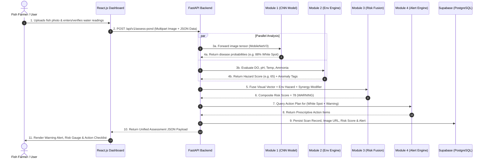

# Proposed Solution: AquaGuard AI System Architecture & Technical Design

## 1. System Vision & Architecture Overview
**AquaGuard AI** is an intelligent, accessible, multimodal disease risk detection and early warning platform engineered specifically for freshwater aquaculture pond ecosystems. It unifies computer vision-driven exterior pathogen screening with real-time physicochemical pond water telemetry to calculate actionable, early-stage disease risk scores and deliver automated, non-antibiotic mitigation advisories to fish farmers.

The system is designed with a decoupled, modular service-oriented architecture:
* **Frontend Presentation Layer:** React.js single-page application styled with Bootstrap 5 and modern responsive components.
* **Backend Application & Inference Layer:** High-performance asynchronous Python FastAPI web service hosting the machine learning inference pipelines.
* **Persistence & Real-time Layer:** Supabase (PostgreSQL, Storage for diagnostic images, Row-Level Security, and Realtime event subscriptions).
* **AI/ML Engine:** TensorFlow / ONNX Runtime (MobileNetV3 image classifier) and Scikit-learn (Random Forest water quality hazard evaluator) orchestrated by a probabilistic risk fusion algorithm.

```mermaid
flowchart TD
    subgraph Client ["Client Presentation Tier (React.js + Bootstrap 5)"]
        UI_Dash["Pond Health Dashboard"]
        UI_Scan["Fish Image Diagnostic Scanner"]
        UI_Tele["Water Quality Telemetry Monitor"]
        UI_Alert["Early Warning & Advisory View"]
        UI_Hist["Historical Analytics & Logs"]
    end

    subgraph API ["Application & Inference Tier (Python FastAPI)"]
        Router["FastAPI Gateway / Router"]
        Mod1["Module 1: AI Fish Image Classifier (MobileNetV3)"]
        Mod2["Module 2: Water Quality Analyzer (Random Forest + Rules)"]
        Mod3["Module 3: Multimodal Risk Fusion Engine"]
        Mod4["Module 4: Early Warning & Advisory Generator"]
    end

    subgraph Storage ["Cloud Persistence Tier (Supabase)"]
        DB[(Supabase PostgreSQL)]
        StorageBucket["Supabase Object Storage (Fish Images)"]
        RealtimePubSub["Supabase Realtime (Alert Pub/Sub)"]
    end

    %% Interactions
    UI_Scan -->|POST /api/v1/analyze-fish (Multipart Image)| Router
    UI_Tele -->|POST /api/v1/water-quality (JSON Telemetry)| Router
    UI_Dash -->|GET /api/v1/ponds/{id}/status| Router
    
    Router --> Mod1
    Router --> Mod2
    Mod1 --> Mod3
    Mod2 --> Mod3
    Mod3 --> Mod4
    
    Mod1 -->|Store Image & BBox| StorageBucket
    Mod4 -->|Log Scan, Score & Alert| DB
    DB --> RealtimePubSub
    RealtimePubSub -->|Live Alert Push| UI_Alert
    UI_Hist -->|Fetch Logs & Charts| DB
```

---

## 2. Detailed Module Breakdown

### 2.1 Module 1: AI-Based Fish Image Analysis
* **Core Function:** Ingests standard RGB photos of fish (captured via mobile camera during net checks or surface feeding) and outputs multi-class disease probability distributions.
* **Technical Implementation:**
  * **Image Preprocessing:** Ingestion via FastAPI `UploadFile`. Resizing to $224 \times 224 \times 3$, normalization, and optional CLAHE contrast equalization for underwater glare/murkiness.
  * **Model Backbone:** Fine-tuned `MobileNetV3-Large` pre-trained on ImageNet.
  * **Class Labels:**
    1. `Healthy Fish`
    2. `Ichthyophthiriasis (White Spot)`
    3. `Fin and Tail Rot`
    4. `Columnaris Disease`
    5. `Saprolegniasis (Water Mold)`
    6. `Dropsy / Ascites`
    7. `Epizootic Ulcerative Syndrome (EUS)`
* **Output Payload:**
  * Top-1 predicted pathology class and confidence percentage ($P_{disease}$).
  * Top-3 differential diagnosis probability breakdown.
  * Detected visual symptom descriptors (e.g. `["punctate_white_nodules", "fin_fraying"]`).
  * Uploaded image URL stored in Supabase Storage.

---

### 2.2 Module 2: Pond Water-Quality Monitoring
* **Core Function:** Tracks and evaluates physical and chemical pond variables, identifying deviations from species-specific biological safety ranges.
* **Supported Telemetry Parameters:**
  * **Dissolved Oxygen ($DO$):** Measured in $\text{mg/L}$ (Critical: $< 3.5 \text{ mg/L}$, Ideal: $5.0 - 8.0 \text{ mg/L}$).
  * **Water Temperature ($T$):** Measured in $^\circ\text{C}$ (Monitors rapid diurnal drops $> 3^\circ\text{C}$).
  * **Potential of Hydrogen ($pH$):** Scale $0 - 14$ (Critical: $< 6.2$ or $> 8.8$, Ideal: $6.8 - 7.8$).
  * **Total Ammonia Nitrogen ($TAN$):** In $\text{mg/L}$; computes un-ionized ammonia ($NH_3$).
  * **Turbidity / Secchi Depth:** In $\text{NTU}$ / $\text{cm}$ (Flags algal blooms or muddy silt runoff).
* **Technical Implementation:**
  * Dual-mode input: (a) Manual slider/form entry on the web UI for smallholders without sensors, and (b) Simulated IoT stream / REST API endpoint for automated probes.
  * **Inference:** Evaluated through the Tier 1 Biological Safety Guardrail and the Scikit-learn Random Forest Water Hazard Regressor.
  * **Output:** Normalized **Environmental Hazard Score ($H_{env} \in [0, 100]$)** and parameter breach tags (e.g. `["HYPOXIA_CRITICAL", "AMMONIA_STRESS"]`).

---

### 2.3 Module 3: Fish Disease Risk Assessment
* **Core Function:** The mathematical bridge uniting visual evidence and environmental conditions into a unified risk metric.
* **Mathematical Fusion Algorithm:**
  $$R_{pond} = \min\left(100, \; 0.55 \cdot (P_{max} \times 100) + 0.45 \cdot H_{env} + S(C_{disease}, \mathbf{X}_{env})\right)$$
* **Contextual Biological Synergy ($S$):**
  * Matches specific pathogens to their specific environmental multipliers (e.g. *Saprolegniasis* with low temperatures; *Columnaris* with warm, high-pH waters; *Aeromonas* with severe hypoxia).
* **Risk Categorization:**
  * **0 – 30:** **NORMAL (Green)** — Low risk; stable biosecurity.
  * **31 – 60:** **ADVISORY (Yellow)** — Moderate stress; environmental correction required.
  * **61 – 80:** **WARNING (Orange)** — High disease risk; immediate intervention required.
  * **81 – 100:** **EMERGENCY (Red)** — Active disease outbreak or lethal water conditions.

---

### 2.4 Module 4: Early Warning and Notifications
* **Core Function:** Automatically dispatches alerts and actionable prescriptions the instant risk thresholds are crossed.
* **Alert Delivery Channels:**
  * **In-App Toast & Modal Notifications:** Real-time visual banners on the React dashboard via Supabase Realtime WebSocket listeners.
  * **Simulated SMS / WhatsApp Dispatches:** Formatted SMS text payloads ready for integration with Twilio or Africa's Talking for rural farmers lacking 4G data.
* **Prescriptive Action Plan Generator:**
  * Generates concrete non-antibiotic mitigation protocols tailored to the exact breach (e.g. emergency aeration hours, agricultural lime calculation based on pond volume, saline bath immersion durations).

---

### 2.5 Module 5: Pond Health Dashboard
* **Core Function:** Serves as the primary farmer-facing single-pane-of-glass management interface.
* **Key Components:**
  * **Pond Overview Grid:** Multi-pond status cards (e.g. Pond #1: Safe, Pond #2: High Risk).
  * **Live Risk Gauge:** Interactive SVG semi-circular gauge displaying the composite $R_{pond}$ score (0 to 100) with color-coded warning bands.
  * **Water Quality Telemetry Matrix:** Real-time progress bars and gauges for DO, pH, Temperature, and Ammonia with optimal threshold markers.
  * **Quick-Scan Camera Widget:** Drag-and-drop or live mobile webcam capture modal with instant diagnosis overlay.
  * **One-Click Pre-loaded Demo Scenarios:** Instant test buttons (e.g. *"Simulate Night Hypoxia"*, *"Simulate White Spot Outbreak"*, *"Optimal Pond State"*) for rapid judge evaluation.

---

### 2.6 Module 6: Historical Reports & Monitoring
* **Core Function:** Long-term archival, trend analysis, and PDF/CSV report generation for farm audit and veterinary consultation.
* **Capabilities:**
  * Time-series interactive line charts (Chart.js / Recharts) graphing DO, pH, and Temperature over 24-hour and 7-day intervals.
  * Searchable historical diagnostic gallery with thumbnail images, predicted diseases, and timestamps.
  * Diagnostic Summary Export: Client-side printable PDF summary formatted for local government fisheries extension officers.

---

## 3. Inter-Module Communication & Sequence Workflow

The sequence below illustrates the end-to-end data flow when a farmer conducts a pond inspection:



---

## 4. RESTful API Specification (FastAPI)

### 4.1 Endpoints Overview

| Method | Endpoint | Description | Request Payload | Response Payload |
| :--- | :--- | :--- | :--- | :--- |
| `POST` | `/api/v1/analyze-fish` | Standalone fish disease image classification | `multipart/form-data` (`image`: File) | `{ predicted_disease, confidence, top_3, symptoms }` |
| `POST` | `/api/v1/water-quality` | Standalone water quality hazard analysis | `application/json` (`do_mg_l`, `ph`, `temp_c`, `tan_mg_l`) | `{ hazard_score, status, anomalies }` |
| `POST` | `/api/v1/assess-pond` | Full multimodal risk assessment | Multipart (`image`: File, `water_data`: JSON string) | `{ risk_score, risk_tier, disease_info, water_info, action_plan }` |
| `GET` | `/api/v1/ponds` | List all monitored ponds | None | `Array<{ pond_id, name, current_risk, last_scan }>` |
| `GET` | `/api/v1/ponds/{id}/history`| Retrieve time-series telemetry & scan logs | Query: `limit`, `days` | `{ telemetry_history: [...], scan_history: [...] }` |

### 4.2 Comprehensive Multimodal Response Schema (`/api/v1/assess-pond`)
```json
{
  "scan_id": "scan_89f4b12c-9821-4f32",
  "timestamp": "2026-10-31T19:05:00Z",
  "pond_id": "pond_01",
  "risk_assessment": {
    "composite_risk_score": 78.4,
    "severity_tier": "WARNING",
    "color_code": "#FF8C00",
    "status_title": "Elevated Disease Outbreak Risk"
  },
  "visual_diagnosis": {
    "primary_condition": "Ichthyophthiriasis (White Spot Disease)",
    "confidence_score": 0.884,
    "top_3_differential": [
      {"condition": "Ichthyophthiriasis", "probability": 0.884},
      {"condition": "Saprolegniasis", "probability": 0.072},
      {"condition": "Healthy Fish", "probability": 0.044}
    ],
    "image_url": "https://supabase.co/storage/v1/object/public/fish-scans/scan_89f4.jpg"
  },
  "environmental_health": {
    "hazard_score": 65.0,
    "telemetry": {
      "dissolved_oxygen_mg_l": 3.8,
      "ph": 7.4,
      "temperature_c": 21.5,
      "un_ionized_ammonia_mg_l": 0.04
    },
    "anomalies_detected": [
      "Moderate Hypoxia (DO < 4.0 mg/L)",
      "Recent Temperature Drop (>2.5 C in 24h)"
    ]
  },
  "synergy_interaction": {
    "synergy_detected": true,
    "synergy_factor_added": 15.0,
    "explanation": "Rapid water temperature decline strongly accelerates Ich trophont virulence."
  },
  "prescriptive_action_plan": [
    {
      "priority": 1,
      "category": "Immediate Biosecurity",
      "instruction": "Isolate Pond #1 equipment. Do not share nets or buckets with adjacent ponds."
    },
    {
      "priority": 2,
      "category": "Aeration",
      "instruction": "Turn on supplemental aerator. Parasitized gills require DO > 5.5 mg/L to prevent suffocation."
    },
    {
      "priority": 3,
      "category": "Therapeutic Bath",
      "instruction": "Prepare a 3-5 g/L non-iodized salt bath for affected batch during next sampling."
    }
  ]
}
```

---

## 5. Database Schema (Supabase / PostgreSQL)

```sql
-- Ponds Table
CREATE TABLE ponds (
    id UUID PRIMARY KEY DEFAULT gen_random_uuid(),
    farm_id UUID NOT NULL,
    name VARCHAR(100) NOT NULL,
    species_farmed VARCHAR(100) NOT NULL, -- e.g. "Nile Tilapia", "Indian Major Carp"
    area_sq_meters NUMERIC(10,2),
    depth_meters NUMERIC(4,2),
    created_at TIMESTAMPTZ DEFAULT NOW()
);

-- Water Quality Telemetry Table
CREATE TABLE water_quality_logs (
    id UUID PRIMARY KEY DEFAULT gen_random_uuid(),
    pond_id UUID REFERENCES ponds(id) ON DELETE CASCADE,
    recorded_at TIMESTAMPTZ DEFAULT NOW(),
    dissolved_oxygen NUMERIC(5,2) NOT NULL, -- mg/L
    ph NUMERIC(4,2) NOT NULL,
    temperature NUMERIC(5,2) NOT NULL, -- Celsius
    ammonia NUMERIC(5,3), -- mg/L
    turbidity NUMERIC(6,2), -- NTU
    hazard_score NUMERIC(5,2) NOT NULL
);

-- Diagnostic Scans Table
CREATE TABLE diagnostic_scans (
    id UUID PRIMARY KEY DEFAULT gen_random_uuid(),
    pond_id UUID REFERENCES ponds(id) ON DELETE CASCADE,
    scanned_at TIMESTAMPTZ DEFAULT NOW(),
    image_url TEXT NOT NULL,
    predicted_disease VARCHAR(100) NOT NULL,
    confidence NUMERIC(5,4) NOT NULL,
    composite_risk_score NUMERIC(5,2) NOT NULL,
    risk_tier VARCHAR(50) NOT NULL, -- 'NORMAL', 'ADVISORY', 'WARNING', 'EMERGENCY'
    advisory_payload JSONB NOT NULL
);

-- Alerts Table
CREATE TABLE alerts (
    id UUID PRIMARY KEY DEFAULT gen_random_uuid(),
    pond_id UUID REFERENCES ponds(id) ON DELETE CASCADE,
    scan_id UUID REFERENCES diagnostic_scans(id),
    created_at TIMESTAMPTZ DEFAULT NOW(),
    severity VARCHAR(50) NOT NULL,
    message TEXT NOT NULL,
    is_resolved BOOLEAN DEFAULT FALSE,
    resolved_at TIMESTAMPTZ
);
```

---

## 6. Offline Resilience & Progressive Web Capabilities
Because rural fish farms frequently encounter intermittent cellular coverage:
* **Client-Side Cache (IndexedDB):** Stores past scan reports, water telemetry logs, and advisory guides locally on the farmer's device.
* **Offline Telemetry Queuing:** If network connectivity drops while recording pond parameters, entries are queued locally in browser `localStorage` / `IndexedDB` and synchronized with Supabase via background sync once connectivity resumes.
* **Lightweight Payloads:** Image uploads are pre-compressed client-side (HTML5 Canvas compression) before transmission, reducing upload sizes from 8 MB to <300 KB for rapid upload over 2G/3G connections.

